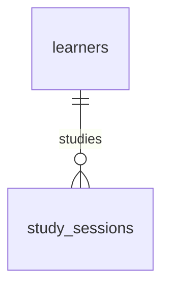

# Từ điển dữ liệu

| Bảng | Mỗi dòng | Cột |
|---|---|---|
| learners | Một người học | learner_id, name |
| study_sessions | Một buổi học | session_id, learner_id, studied_on, minutes |

Ngày dùng lịch Việt Nam. Một chuỗi là nhóm ngày học liên tiếp. weeks.csv có tám tuần mỗi người. Trong summary.csv, best_weeks gồm mọi ngày thứ Hai đồng hạng có ít nhất một ngày học. Người chưa học có best_days và longest_streak bằng 0 và best_weeks trống.

DISTINCT bỏ ngày lặp. ROW_NUMBER đánh số ngày trong mỗi người. GROUP BY gom các ngày cùng khóa chuỗi. LEFT JOIN giữ tuần trống.
